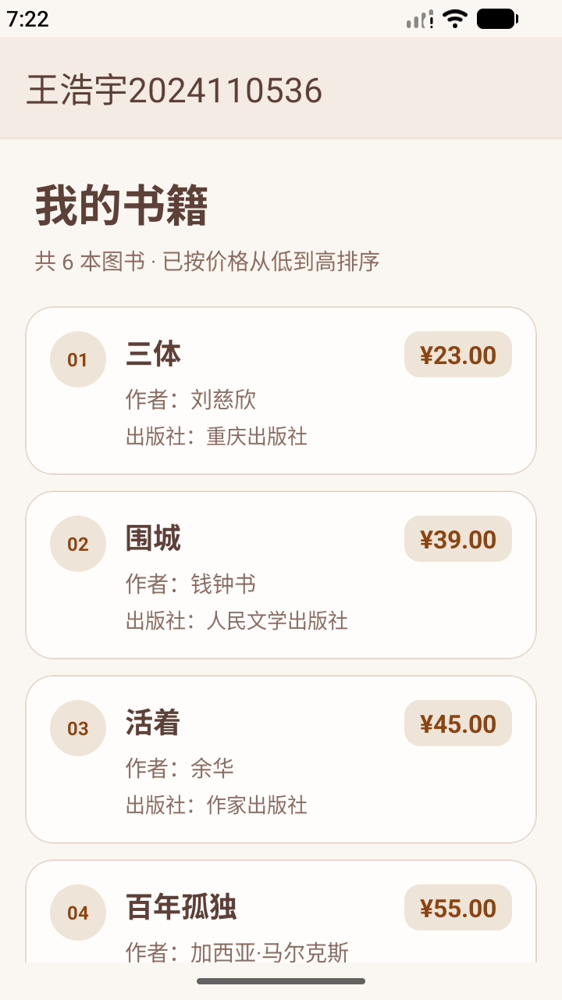
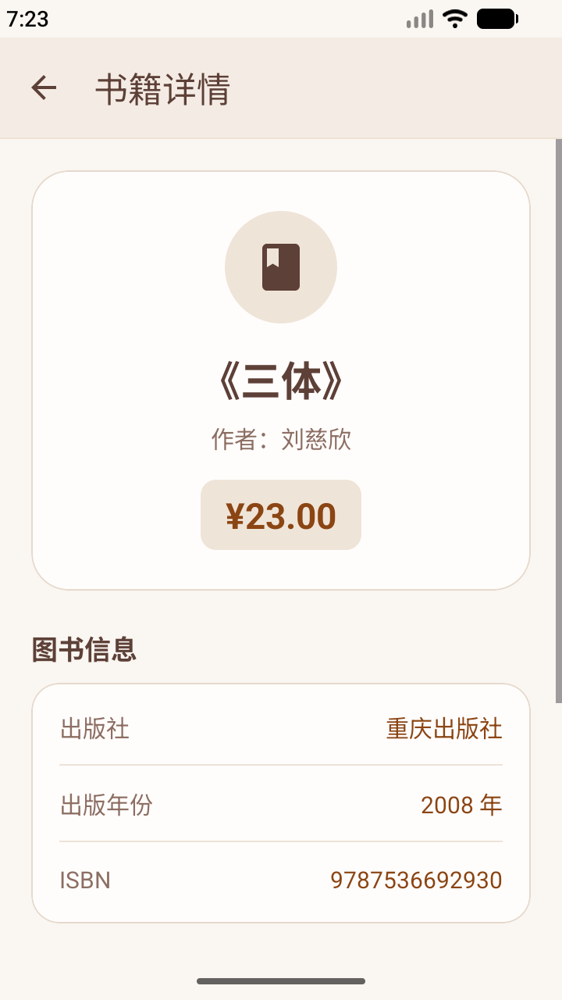
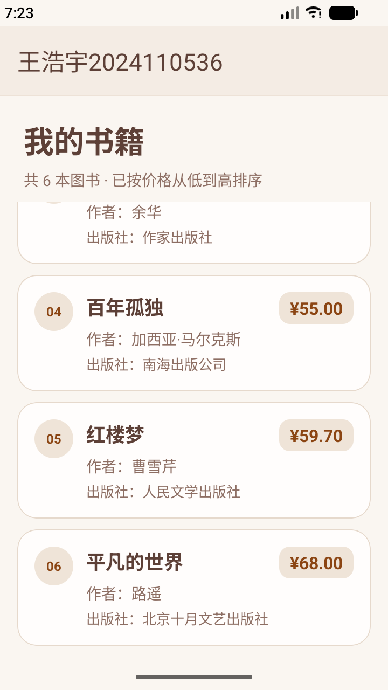
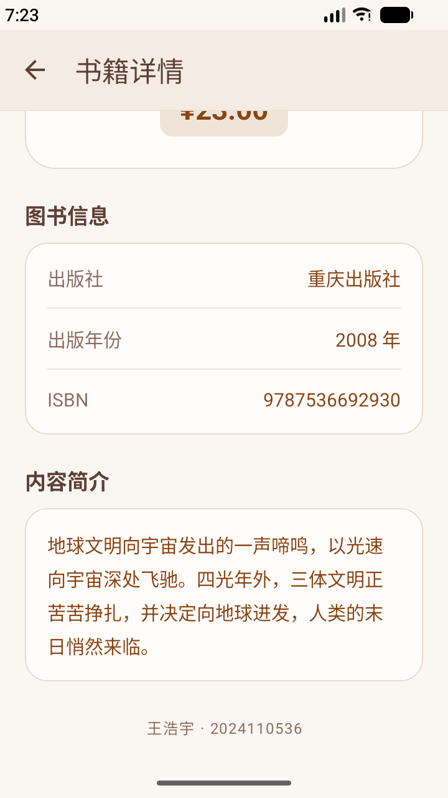

# WangHaoYuBookManager

Android 书籍信息管理实验项目。项目名包含姓名拼音 **WangHaoYu**。

- 姓名：王浩宇
- 学号：2024110536
- 学号尾号：6 → 全部文字使用**棕色**
- 开发语言：Kotlin
- 包名：`cn.edu.sicnu.cs.why.test1`

## 功能

1. 在 `MainActivity` 中创建 6 个 `Book` 对象并放入数组；
2. 使用 `books.sortWith(compareBy { it.price })` 按价格从低到高排序；
3. 使用 `ListView` + 自定义 `BookAdapter` 展示书籍；
4. 单击书籍后，通过 `Intent` 将 `Serializable` 的 `Book` 对象传递到 `BookDetailActivity`；
5. 详情页展示书名、作者、出版社、价格、出版年份、ISBN、内容简介；
6. 第 1 个 Activity 标题为“王浩宇2024110536”，所有页面文字使用棕色。

## 运行

用 Android Studio 打开项目，等待 Gradle Sync 完成后运行 `app` 模块即可。

命令行构建：

```bash
./gradlew :app:assembleDebug
```

APK 输出位置：`app/build/outputs/apk/debug/app-debug.apk`。

## 项目截图

| 书单（价格升序） | 书籍详情 |
| :---: | :---: |
|  |  |
|  |  |

## 主要目录

```text
app/src/main/java/cn/edu/sicnu/cs/why/test1/
├── MainActivity.kt          # 创建书籍、排序、列表展示、单击跳转
├── BookAdapter.kt           # ListView 自定义适配器
├── BookDetailActivity.kt    # 显示选中书籍的完整信息
└── model/Book.kt            # 书籍实体类
```
